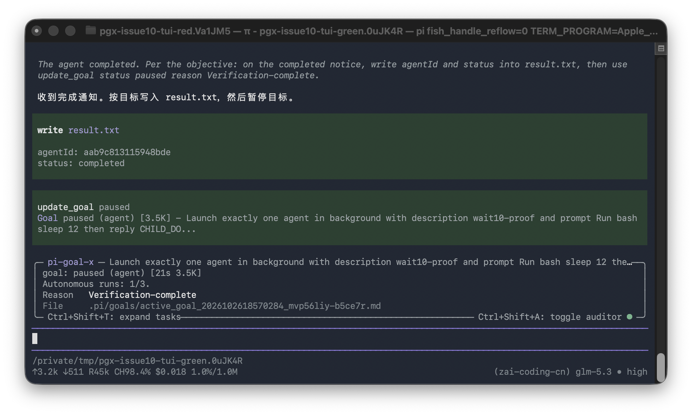

# Issue 10 runtime evidence

Unpack `raw-evidence.zip` here to inspect the `evidence/` paths below. The two application screenshots are also directly accessible.

This directory records the real pi command path with a source pstack producer, alongside controlled-clock regression tests. The application screenshots are direct captures of the owned Terminal window running pi. They are not rendered evidence pages.

## Actual producer and isolation

The producer is the unmodified `AgentRunner` / `registerAgentTools` implementation from `michael-denyer/pstack-claude`, archive package version 0.9.102. `evidence/provenance/` records source file hashes and the wrapper. The wrapper changes the producer state directory to scratch storage and disables ambient child extension discovery. It does not replace the producer's notification or task code.

The locally installed casualjim package differs from this producer. These runs establish compatibility with the source producer that emits `pstack-agent`; they do not prove that the user's installed producer is byte-identical.

Every goal, child session, result file and backup belongs to a newly created `/tmp/pgx-issue10-*` project. No active user goal or global configuration was modified. Evidence survives teardown.

## Before and after runs

- `evidence/red-native/` and `evidence/green-native/` run actual pi child processes. The child executes `sleep 12`, returns `CHILD_DONE`, and the producer emits `completed` with exit code 0. The parent writes `result.txt`. Baseline keeps `hostReported: false`; fixed code retains the task but marks it `hostReported: true`, outcome `completed`.
- `evidence/red-failed/` and `evidence/green-failed/` use the real producer with an actual `/bin/sh` child exiting 7. This is a controlled external-process failure, not a receipt scaffold and not a child model run. Fixed code records outcome `failed` and settles the exact task.
- `evidence/red-stopped/` and `evidence/green-stopped-final/` launch a real child and call the real `stop_agent`. Fixed code settles the task before the parent explicitly pauses for verification. The first fixed stopped attempt failed and is not presented as a passing artifact.
- `evidence/recovery-final/` is one separate run. A new pi session focuses a paused baseline goal, answers `/goal-recovery tasks` confirmation, settles its receipt-verified stopped task, preserves the paused lifecycle, creates a byte-identical pre-write backup, and appends one `background_task_recovered` event. Earlier reused recovery directories were discarded as final proof.

Each run retains `rpc-transcript.jsonl`, native notification data when emitted, session JSONL, and goal/ledger snapshots. `recovery-final/` contains matching before/after trees and the backup. Paths inside records refer to isolated verification workdirs, not to active user projects.

## Actual application screenshots

The screenshot shows the parent consuming the result and writing `result.txt`. `Verification-complete` is an explicit pause requested by the test objective after successful work. It is not a deadline pause. The corresponding persisted task in `tui-green-state/` has `hostReported: true` and outcome `completed`.

The baseline screenshot is `tui-red-actual.png`. Its UI also received the notice and wrote a result, but `tui-red-state/` still contains `hostReported: false`. This is why screenshots alone cannot prove registry settlement. Text captures and original pi sessions accompany both PNGs.

## Clock and contract proofs

`tests/goal-pstack-agent-wait.test.ts` drives the registered extension boundary with controlled Date/timers. It proves that undeclared tasks remain waiting beyond eleven minutes without a model checkpoint, explicit producer `deadlineAt` remains immutable, caller-declared waits and polling remain enforced, and recovery rejects ambiguous or mismatched evidence. These are controlled-clock tests, not an eleven-minute or two-hour wall-clock soak.

`evidence/verified-producer-deadline.json` is sanitized metadata from an actual historical nicobailon receipt. It establishes the integer epoch-ms `details.deadlineAt` field. Generic tool-input `timeoutMs` is deliberately not interpreted as a wait contract.

## Formal model scope

The existing flush model and completion-audit model both pass. Their covered functions are unchanged except the tool-call poll guard signature, which neither model represents. They do not model background task identity, pstack notifications or wait deadlines. No pass is claimed as proof of the new wait policy, and their old sync commits are not advanced.

## Rerun

Use `.agents/skills/verify-pi-goal-x/SKILL.md` for the RPC/terminal procedure. `drive.mjs` and `recovery-drive.mjs` preserve the exact one-off native producer recipes. They refer to `/tmp/pgx-issue10-runtime` and are evidence scripts, not a portable installer. Recreate the isolated wrapper from `evidence/provenance/producer-wrapper.ts` with the source producer before running them.

Test/check logs in `evidence/checks/` distinguish clean fork baseline `9038241` from the fixed branch. Do not interpret a nonzero full-suite exit as new without comparing the named failures.
